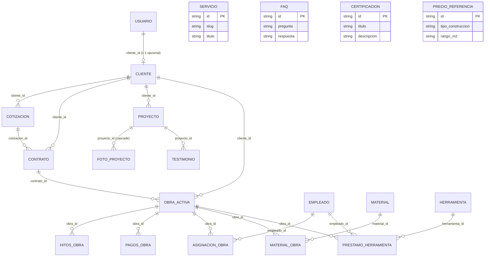

# Base de Datos — Contr-art Demo
> Esquema Prisma actual (PostgreSQL / Neon) — 20 tablas
---
## Resumen por módulos
| Módulo | Tablas |
|--------|--------|
| Acceso y clientes | `usuarios`, `clientes` |
| Proceso de venta | `cotizaciones`, `contratos`, `precio_referencia` |
| Sitio web (portafolio) | `proyectos`, `fotos_proyecto`, `testimonios`, `servicios`, `faqs`, `certificaciones` |
| Obras en ejecución | `obras_activas`, `hitos_obra`, `pagos_obra` |
| **Empleados (nuevo)** | `empleados`, `asignaciones_obra` |
| **Materiales (nuevo)** | `materiales`, `materiales_obra` |
| **Herramientas (nuevo)** | `herramientas`, `prestamos_herramienta` |
---
## Módulo 1 — Acceso y clientes
### 1. `usuarios` (Usuario)
| Campo | Tipo | Constraints | Descripción |
|-------|------|-------------|-------------|
| `id` | `String` | `@id @default(cuid())` | PK |
| `nombre` | `String` | | Nombre(s) |
| `apellidos` | `String` | | Apellidos *(nuevo)* |
| `email` | `String` | `@unique` | Login único |
| `password_hash` | `String` | `@map("password_hash")` | bcrypt hash |
| `rol` | `Rol` | `@default(cliente)` | admin / cliente (nunca default admin) |
| `cliente_id` | `String?` | `@unique @map("cliente_id")` | FK → `clientes.id` (1:1 opcional) |
| `activo` | `Boolean` | `@default(true)` | Soft enable/disable |
| `creado_en` | `DateTime` | `@default(now()) @map("creado_en")` | Timestamp |
**Relaciones**
- `cliente` → `Cliente` (1:1, opcional, por `cliente_id`)
---
### 2. `clientes` (Cliente)
| Campo | Tipo | Constraints | Descripción |
|-------|------|-------------|-------------|
| `id` | `String` | `@id @default(cuid())` | PK |
| `nombre` | `String` | | Nombre(s) |
| `apellidos` | `String` | | Apellidos *(nuevo)* |
| `telefono` | `String` | | Número de teléfono, contacto principal *(antes `whatsapp`)* |
| `email` | `String?` | `@unique` | Opcional — llave natural de dedupe |
| `ciudad` | `String?` | | Opcional |
| `creado_en` | `DateTime` | `@default(now()) @map("creado_en")` | Timestamp |
**Relaciones**
- `usuario` → `Usuario` (1:1, inverse)
- `cotizaciones` → `Cotizacion[]` (1:N)
- `contratos` → `Contrato[]` (1:N)
- `proyectos` → `Proyecto[]` (1:N)
- `obras` → `ObraActiva[]` (1:N)
---
## Módulo 2 — Proceso de venta
### 3. `cotizaciones` (Cotizacion)
| Campo | Tipo | Constraints | Descripción |
|-------|------|-------------|-------------|
| `id` | `String` | `@id @default(cuid())` | PK |
| `cliente_id` | `String` | `@map("cliente_id")` | FK → `clientes.id` (obligatorio) |
| `tipo_obra` | `TipoObra` | `@map("tipo_obra")` | Enum |
| `tipo_construccion` | `TipoConstruccion` | `@map("tipo_construccion")` | Enum |
| `rango_m2` | `RangoM2` | `@map("rango_m2")` | Enum |
| `ubicacion_obra` | `String?` | `@map("ubicacion_obra")` | Dirección/ciudad |
| `plazo_inicio` | `PlazoInicio` | `@map("plazo_inicio")` | Enum |
| `origen` | `String` | | `web`, `whatsapp`, `tiktok`, etc. |
| `estado` | `String` | `@default("nuevo")` | Funnel: `nuevo`→`contactado`→`visita_tecnica`→`presupuestado`→`ganado`/`perdido` |
| `monto_estimado` | `Decimal?` | `@db.Decimal(12,2) @map("monto_estimado")` | Estimación inicial |
| `monto_cerrado` | `Decimal?` | `@db.Decimal(12,2) @map("monto_cerrado")` | Valor final acordado |
| `notas_internas` | `String?` | `@map("notas_internas")` | Solo admin |
| `requerimiento` | `String?` | `@map("requerimiento")` | Mensaje del cliente del form público |
| `creado_en` | `DateTime` | `@default(now()) @map("creado_en")` | |
| `actualizado_en` | `DateTime` | `@updatedAt @map("actualizado_en")` | Auto-update |
**Índices**: `cliente_id`, `origen`, `estado`
**Relaciones**
- `cliente` → `Cliente` (N:1)
- `contratos` → `Contrato[]` (1:N)
---
### 4. `contratos` (Contrato)
| Campo | Tipo | Constraints | Descripción |
|-------|------|-------------|-------------|
| `id` | `String` | `@id @default(cuid())` | PK |
| `cliente_id` | `String` | `@map("cliente_id")` | FK → `clientes.id` |
| `cotizacion_id` | `String?` | `@map("cotizacion_id")` | FK → `cotizaciones.id` (opcional) |
| `archivo_pdf_url` | `String?` | `@map("archivo_pdf_url")` | Link a PDF firmado |
| `fecha_firma` | `DateTime?` | `@map("fecha_firma")` | |
| `monto_total` | `Decimal` | `@db.Decimal(12,2) @map("monto_total")` | Valor contractual |
| `observaciones` | `String?` | | |
| `creado_en` | `DateTime` | `@default(now()) @map("creado_en")` | Registro cargado en sistema |
**Relaciones**
- `cliente` → `Cliente` (N:1)
- `cotizacion` → `Cotizacion` (N:1, opcional)
- `obras` → `ObraActiva[]` (1:N)
---
### 5. `precio_referencia` (PrecioReferencia)
> Tabla independiente (sin relaciones): se consulta por `tipo_construccion` + `rango_m2`.

| Campo | Tipo | Constraints | Descripción |
|-------|------|-------------|-------------|
| `id` | `String` | `@id @default(cuid())` | PK |
| `tipo_construccion` | `TipoConstruccion` | `@map("tipo_construccion")` | Enum |
| `rango_m2` | `RangoM2` | `@map("rango_m2")` | Enum |
| `precio_min` | `Decimal` | `@db.Decimal(12,2) @map("precio_min")` | Mínimo por m² |
| `precio_max` | `Decimal` | `@db.Decimal(12,2) @map("precio_max")` | Máximo por m² |
| `vigente_desde` | `DateTime` | `@default(now()) @map("vigente_desde")` | Historial de precios |
**Único compuesto**: `(tipo_construccion, rango_m2, vigente_desde)`
---
## Módulo 3 — Sitio web (portafolio)
### 6. `proyectos` (Proyecto)
| Campo | Tipo | Constraints | Descripción |
|-------|------|-------------|-------------|
| `id` | `String` | `@id @default(cuid())` | PK |
| `cliente_id` | `String?` | `@map("cliente_id")` | FK → `clientes.id` |
| `slug` | `String` | `@unique` | URL amigable |
| `titulo` | `String` | | Nombre del proyecto |
| `tipo_construccion` | `TipoConstruccion` | `@map("tipo_construccion")` | Enum |
| `m2_construidos` | `Int` | `@map("m2_construidos")` | Metraje |
| `dias_ejecucion` | `Int` | `@map("dias_ejecucion")` | Plazo real |
| `ubicacion` | `String` | | Ciudad/barrio |
| `problema_cliente` | `String` | `@map("problema_cliente")` | Pain point |
| `solucion` | `String` | | Qué hicimos |
| `destacado` | `Boolean` | `@default(false)` | Hero/carrusel |
| `publicado` | `Boolean` | `@default(false)` | Visible en web |
| `creado_en` | `DateTime` | `@default(now()) @map("creado_en")` | |
| `actualizado_en` | `DateTime` | `@updatedAt @map("actualizado_en")` | |
**Relaciones**
- `cliente` → `Cliente` (N:1)
- `fotos` → `FotoProyecto[]` (1:N, cascade delete)
- `testimonios` → `Testimonio[]` (1:N)
---
### 7. `fotos_proyecto` (FotoProyecto)
| Campo | Tipo | Constraints | Descripción |
|-------|------|-------------|-------------|
| `id` | `String` | `@id @default(cuid())` | PK |
| `proyecto_id` | `String` | `@map("proyecto_id")` | FK → `proyectos.id` |
| `url` | `String` | | Ruta en `/public/img/` o storage |
| `fase` | `FaseFoto` | | `antes` / `durante` / `despues` |
| `orden` | `Int` | | Orden en galería |
**Índice**: `proyecto_id`
**Relaciones**
- `proyecto` → `Proyecto` (N:1, onDelete: Cascade)
---
### 8. `testimonios` (Testimonio)
| Campo | Tipo | Constraints | Descripción |
|-------|------|-------------|-------------|
| `id` | `String` | `@id @default(cuid())` | PK |
| `proyecto_id` | `String?` | `@map("proyecto_id")` | FK → `proyectos.id` (opcional) |
| `cliente_nombre` | `String` | `@map("cliente_nombre")` | Nombre visible |
| `texto` | `String` | | Testimonio |
| `foto_url` | `String?` | `@map("foto_url")` | Foto cliente/obra |
| `puntaje` | `Int?` | | 1-5 estrellas |
| `autoriza_publicar` | `Boolean` | `@default(false) @map("autoriza_publicar")` | Consentimiento |
| `publicado` | `Boolean` | `@default(false)` | Visible en web |
| `creado_en` | `DateTime` | `@default(now()) @map("creado_en")` | |
| `actualizado_en` | `DateTime` | `@updatedAt @map("actualizado_en")` | |
**Índice**: `proyecto_id`
**Relaciones**
- `proyecto` → `Proyecto` (N:1, opcional)
---
### 9. `servicios` (Servicio)
> Tabla independiente (sin relaciones).

| Campo | Tipo | Constraints | Descripción |
|-------|------|-------------|-------------|
| `id` | `String` | `@id @default(cuid())` | PK |
| `slug` | `String` | `@unique` | URL: `/servicios/[slug]` |
| `titulo` | `String` | | Nombre |
| `descripcion` | `String` | | Detalle |
| `orden` | `Int` | `@default(0)` | Orden en grid |
| `activo` | `Boolean` | `@default(true)` | Visible en web |
---
### 10. `faqs` (Faq)
> Tabla independiente (sin relaciones).

| Campo | Tipo | Constraints | Descripción |
|-------|------|-------------|-------------|
| `id` | `String` | `@id @default(cuid())` | PK |
| `pregunta` | `String` | | |
| `respuesta` | `String` | | |
| `orden` | `Int` | `@default(0)` | Orden en lista |
| `activo` | `Boolean` | `@default(true)` | Visible en web |
---
### 11. `certificaciones` (Certificacion)
> Tabla independiente (sin relaciones).

| Campo | Tipo | Constraints | Descripción |
|-------|------|-------------|-------------|
| `id` | `String` | `@id @default(cuid())` | PK |
| `titulo` | `String` | | Nombre certificado |
| `descripcion` | `String` | | Detalle |
| `activo` | `Boolean` | `@default(true)` | Visible en web |
---
## Módulo 4 — Obras en ejecución
> Portal de cliente y panel admin ya los usan.

### 12. `obras_activas` (ObraActiva)
| Campo | Tipo | Descripción |
|-------|------|-------------|
| `id` | `String` | PK |
| `cliente_id` | `String` | FK → `clientes` |
| `contrato_id` | `String?` | FK → `contratos` |
| `direccion_obra` | `String` | |
| `fecha_inicio` | `DateTime` | |
| `fecha_fin_estimada` | `DateTime?` | |
| `estado` | `EstadoObra` | Enum |
| `progreso` | `Int` | 0-100% |
**Índices**: `cliente_id`, `contrato_id`
**Relaciones**: `cliente`, `contrato`, `hitos[]`, `pagos[]`, `asignaciones[]`, `materiales[]`, `prestamos[]`
---
### 13. `hitos_obra` (HitosObra)
| Campo | Tipo | Descripción |
|-------|------|-------------|
| `id` | `String` | PK |
| `obra_id` | `String` | FK → `obras_activas` |
| `titulo` | `String` | Nombre del hito |
| `descripcion` | `String` | |
| `fecha` | `DateTime` | |
| `foto_url` | `String?` | Evidencia |
| `visible_cliente` | `Boolean` | `@default(false)` |

**Índice**: `obra_id`
---
### 14. `pagos_obra` (PagoObra)
| Campo | Tipo | Descripción |
|-------|------|-------------|
| `id` | `String` | PK |
| `obra_id` | `String` | FK → `obras_activas` |
| `monto` | `Decimal` | `@db.Decimal(12,2)` |
| `fecha` | `DateTime` | |
| `concepto` | `String` | Descripción |
| `comprobante_url` | `String?` | PDF/imagen |
| `estado` | `EstadoPago` | Enum |
**Índice**: `obra_id`
---
## Módulo 5 — Empleados *(nuevo)*
### 15. `empleados` (Empleado)
Personal de la constructora: ingenieros, albañiles, maestros de obra, etc.

| Campo | Tipo | Constraints | Descripción |
|-------|------|-------------|-------------|
| `id` | `String` | `@id @default(cuid())` | PK |
| `nombre` | `String` | | Nombre(s) |
| `apellidos` | `String` | | Apellidos |
| `ci` | `String` | `@unique` | Carnet de identidad |
| `telefono` | `String` | | Contacto |
| `cargo` | `CargoEmpleado` | | Enum: `ingeniero` / `arquitecto` / `maestro_obra` / `albanil` / `electricista` / `plomero` / `ayudante` / `administrativo` |
| `fecha_ingreso` | `DateTime` | `@map("fecha_ingreso")` | Cuándo entró a trabajar |
| `salario` | `Decimal?` | `@db.Decimal(12,2)` | Opcional |
| `activo` | `Boolean` | `@default(true)` | Soft delete |
| `creado_en` | `DateTime` | `@default(now()) @map("creado_en")` | |
**Relaciones**
- `asignaciones` → `AsignacionObra[]` (1:N)
- `prestamos` → `PrestamoHerramienta[]` (1:N)
---
### 16. `asignaciones_obra` (AsignacionObra)
Tabla intermedia: qué empleado trabaja en qué obra (un empleado puede estar en varias obras y una obra tiene varios empleados).

| Campo | Tipo | Constraints | Descripción |
|-------|------|-------------|-------------|
| `id` | `String` | `@id @default(cuid())` | PK |
| `empleado_id` | `String` | `@map("empleado_id")` | FK → `empleados.id` |
| `obra_id` | `String` | `@map("obra_id")` | FK → `obras_activas.id` |
| `rol_en_obra` | `String` | `@map("rol_en_obra")` | Ej: "Encargado de losa" |
| `fecha_inicio` | `DateTime` | `@map("fecha_inicio")` | |
| `fecha_fin` | `DateTime?` | `@map("fecha_fin")` | Null = sigue asignado |
**Índices**: `empleado_id`, `obra_id`
---
## Módulo 6 — Materiales *(nuevo)*
### 17. `materiales` (Material)
Inventario de materiales de construcción (cemento, fierro, ladrillos, arena, etc.).

| Campo | Tipo | Constraints | Descripción |
|-------|------|-------------|-------------|
| `id` | `String` | `@id @default(cuid())` | PK |
| `nombre` | `String` | | Ej: "Cemento portland" |
| `unidad` | `String` | | `bolsa`, `kg`, `m3`, `unidad`, etc. |
| `stock_actual` | `Decimal` | `@db.Decimal(12,2) @map("stock_actual")` | Cantidad disponible |
| `stock_minimo` | `Decimal` | `@db.Decimal(12,2) @map("stock_minimo")` | Alerta de reposición |
| `precio_unitario` | `Decimal` | `@db.Decimal(12,2) @map("precio_unitario")` | Precio de referencia |
| `activo` | `Boolean` | `@default(true)` | Soft delete |
**Relaciones**
- `usos` → `MaterialObra[]` (1:N)
---
### 18. `materiales_obra` (MaterialObra)
Tabla intermedia: qué material se usó en qué obra y cuánto.

| Campo | Tipo | Constraints | Descripción |
|-------|------|-------------|-------------|
| `id` | `String` | `@id @default(cuid())` | PK |
| `obra_id` | `String` | `@map("obra_id")` | FK → `obras_activas.id` |
| `material_id` | `String` | `@map("material_id")` | FK → `materiales.id` |
| `cantidad` | `Decimal` | `@db.Decimal(12,2)` | Cantidad usada |
| `precio_unitario` | `Decimal` | `@db.Decimal(12,2) @map("precio_unitario")` | Precio al momento de usarlo |
| `fecha` | `DateTime` | | |
**Índices**: `obra_id`, `material_id`
---
## Módulo 7 — Herramientas *(nuevo)*
### 19. `herramientas` (Herramienta)
Inventario de herramientas y equipos (taladro, mezcladora, andamios, etc.).

| Campo | Tipo | Constraints | Descripción |
|-------|------|-------------|-------------|
| `id` | `String` | `@id @default(cuid())` | PK |
| `nombre` | `String` | | Ej: "Taladro percutor" |
| `codigo` | `String` | `@unique` | Código interno del inventario |
| `estado` | `EstadoHerramienta` | `@default(disponible)` | Enum: `disponible` / `en_uso` / `mantenimiento` / `baja` |
| `activo` | `Boolean` | `@default(true)` | Soft delete |
**Relaciones**
- `prestamos` → `PrestamoHerramienta[]` (1:N)
---
### 20. `prestamos_herramienta` (PrestamoHerramienta)
Registro de qué empleado se llevó qué herramienta, a qué obra y cuándo la devolvió.

| Campo | Tipo | Constraints | Descripción |
|-------|------|-------------|-------------|
| `id` | `String` | `@id @default(cuid())` | PK |
| `herramienta_id` | `String` | `@map("herramienta_id")` | FK → `herramientas.id` |
| `empleado_id` | `String` | `@map("empleado_id")` | FK → `empleados.id` |
| `obra_id` | `String` | `@map("obra_id")` | FK → `obras_activas.id` |
| `fecha_salida` | `DateTime` | `@map("fecha_salida")` | Cuándo se la llevó |
| `fecha_devolucion` | `DateTime?` | `@map("fecha_devolucion")` | Null = aún no la devuelve |
| `observaciones` | `String?` | | Ej: "Devuelta con la broca rota" |
**Índices**: `herramienta_id`, `empleado_id`, `obra_id`
---
## Diagrama de Relaciones (Mermaid)
Incluye todas las tablas. Las 4 de abajo (`SERVICIO`, `FAQ`, `CERTIFICACION`, `PRECIO_REFERENCIA`) no tienen relaciones con ninguna otra.

---
## Notas de Implementación
- **Nomenclatura**: `snake_case` en BD (`@map`), `camelCase` en código Prisma
- **IDs**: `cuid()` (cortos, URL-safe, ordenables)
- **Timestamps**: `creado_en` (default now), `actualizado_en` (@updatedAt)
- **Soft delete**: `activo` / `publicado` booleans, no hard delete
- **Decimal money**: `@db.Decimal(12,2)` para ARS
- **Tablas intermedias**: `asignaciones_obra`, `materiales_obra` y `prestamos_herramienta` resuelven relaciones muchos-a-muchos (empleado↔obra, material↔obra, herramienta↔empleado↔obra).
- **Enums nuevos**: `CargoEmpleado` y `EstadoHerramienta` deben agregarse al `schema.prisma`.
- **NextAuth**: Sesiones JWT sobre `usuarios`. Nota: `@auth/prisma-adapter` está configurado en código pero las tablas del adapter (`account`, `session`, `verification_token`, `authenticator`) NO existen en el schema; con strategy JWT + Credentials no se usan, pero el adapter está de más (ver decisión pendiente).